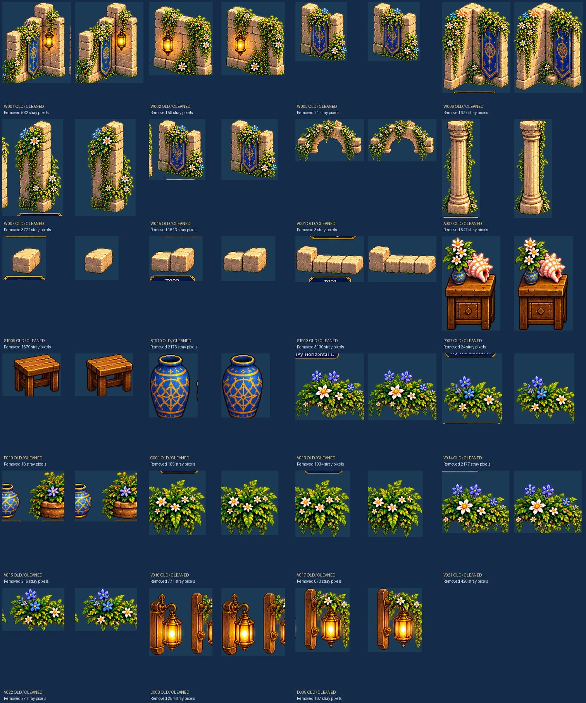

# Pixel-art quality review — compared with Hero Room reference

A file existing is not proof it matches the detailed 1990s-style seaside JRPG room.
The reference calls for intricate sandstone, dense flowered ivy, clean transparent
sprites, blue and gold furniture, strong stylized pixel clusters and consistent
3/4 overhead perspective.

## Confirmed technical problems

* Multiple cropped sprites contain unrelated label-border lines and neighboring fragments.
* The hero and fairy first-pass characters need more native artistic detail.
* Flooring tile seams, palette alignment, ocean animations and contact shadows need
  visual approval inside the running Godot scene.

## Repairs pushed in this audit

- W001: 582 unrelated pixels removed.
- W002: 59 unrelated pixels removed.
- W003: 21 unrelated pixels removed.
- W006: 677 unrelated pixels removed.
- W007: 3772 unrelated pixels removed.
- W015: 1613 unrelated pixels removed.
- A001: 3 unrelated pixels removed.
- A007: 547 unrelated pixels removed.
- ST009: 1679 unrelated pixels removed.
- ST010: 2176 unrelated pixels removed.
- ST013: 3130 unrelated pixels removed.
- P007: 24 unrelated pixels removed.
- P010: 16 unrelated pixels removed.
- O001: 185 unrelated pixels removed.
- V013: 1934 unrelated pixels removed.
- V014: 2177 unrelated pixels removed.
- V015: 215 unrelated pixels removed.
- V016: 771 unrelated pixels removed.
- V017: 873 unrelated pixels removed.
- V021: 426 unrelated pixels removed.
- V022: 27 unrelated pixels removed.
- D008: 254 unrelated pixels removed.
- D009: 167 unrelated pixels removed.

## Before / after image

## Remaining quality flags (not automatic disqualifications)

- art_director_review: 45
- character_fidelity_review: 12
- floor_not_square: 10
- detached_alpha_speckles: 6
- low_texture_detail: 2

Machine-readable report: map_factory/metadata/quality_review.json
All assets remain needs_cleanup until manual fidelity review.
Stable IDs, exact image dimensions, pivots and collisions preserved.
