# Sprite review gallery

These are review thumbnails ONLY. Production textures live as separate PNGs under map_factory/parts/.

Draft art is not approved until a person checks native pixel detail, clean alpha, lighting, tile seams, scale, origin, collisions and shadow.

## Architecture

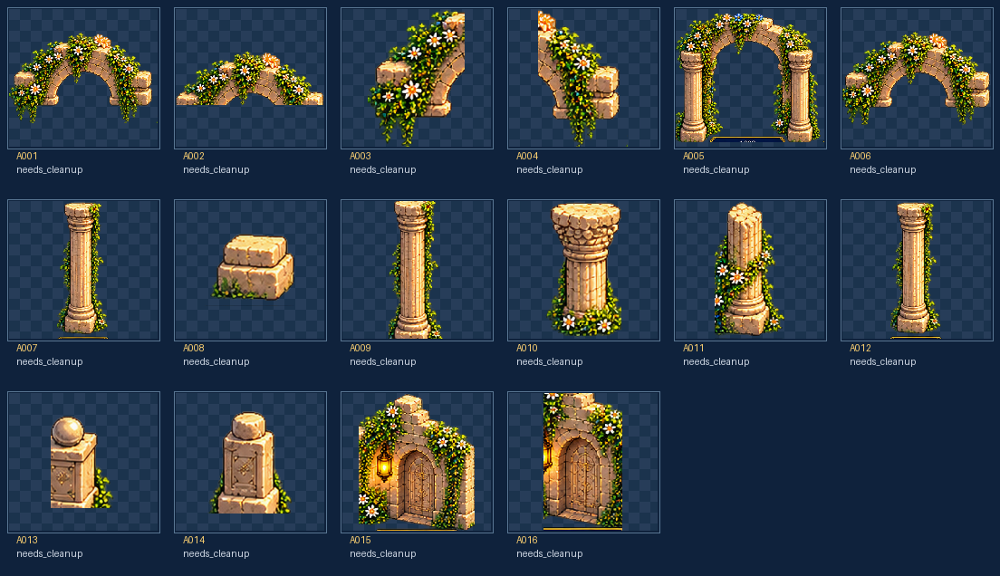

**16 PNGs** | Actual files: [map_factory/parts/architecture](../map_factory/parts/architecture)

## Characters

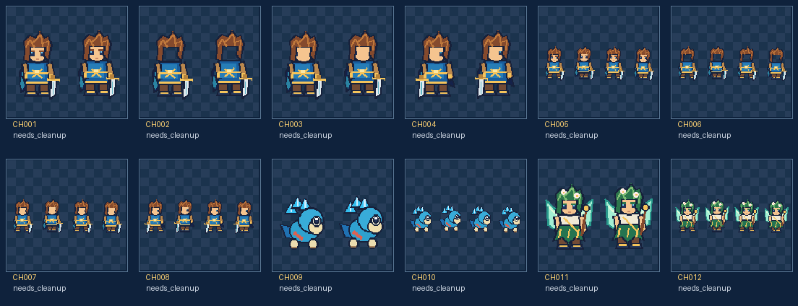

**12 PNGs** | Actual files: [map_factory/parts/characters](../map_factory/parts/characters)

## Decor

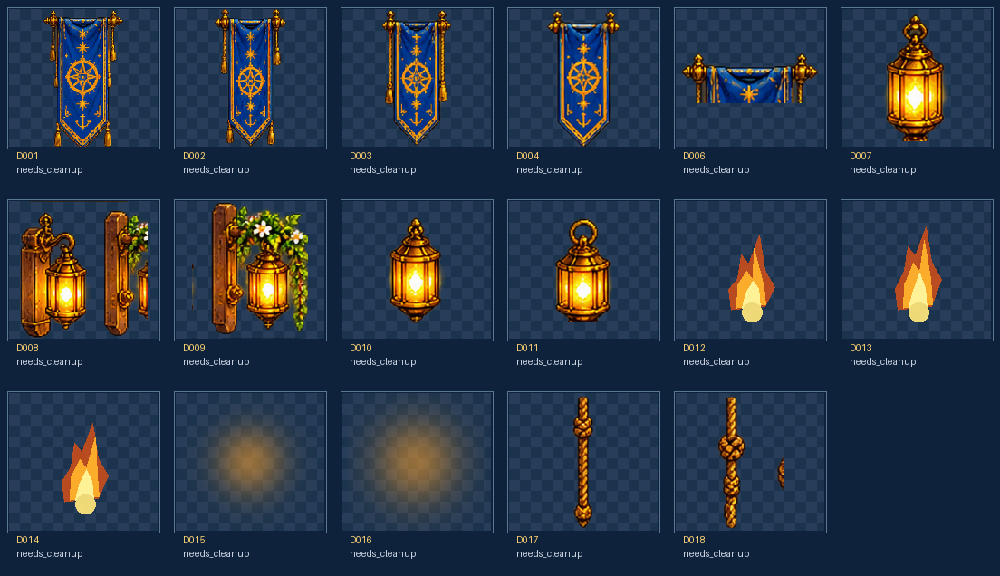

**17 PNGs** | Actual files: [map_factory/parts/decor](../map_factory/parts/decor)

## Environment

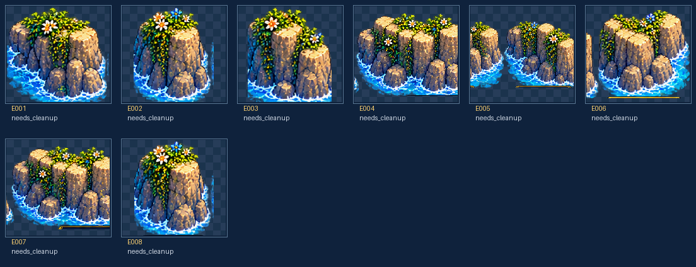

**8 PNGs** | Actual files: [map_factory/parts/environment](../map_factory/parts/environment)

## Floors

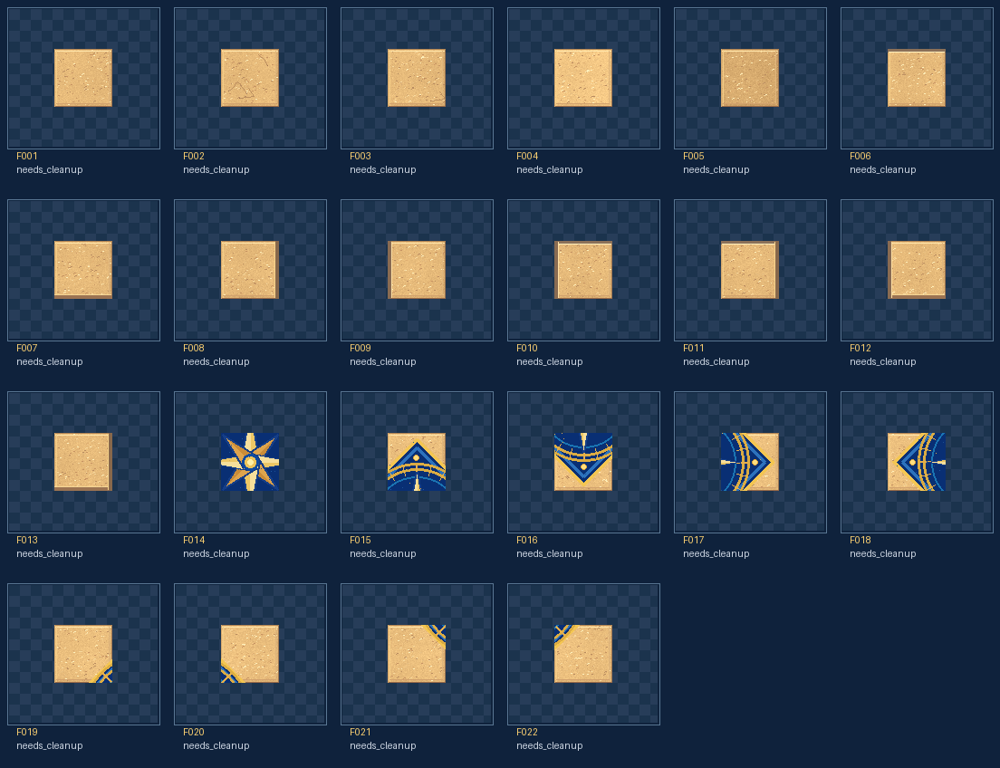

**22 PNGs** | Actual files: [map_factory/parts/floors](../map_factory/parts/floors)

## Furniture

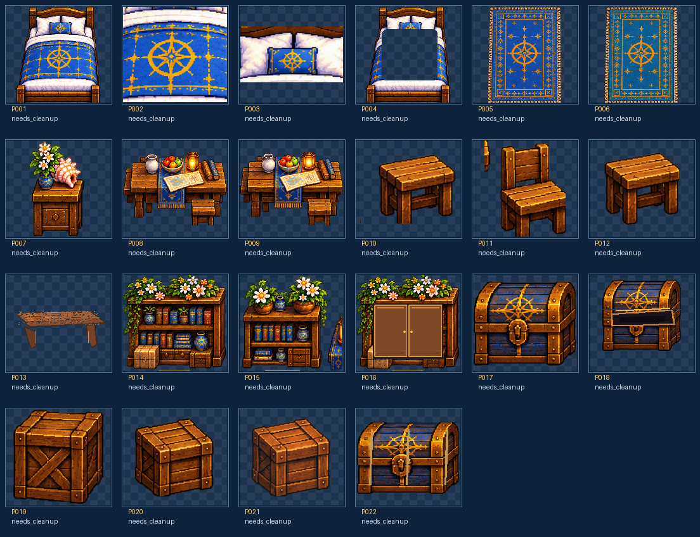

**13 PNGs** | Actual files: [map_factory/parts/furniture](../map_factory/parts/furniture)

## Objects

**19 PNGs** | Actual files: [map_factory/parts/objects](../map_factory/parts/objects)

## Shadows

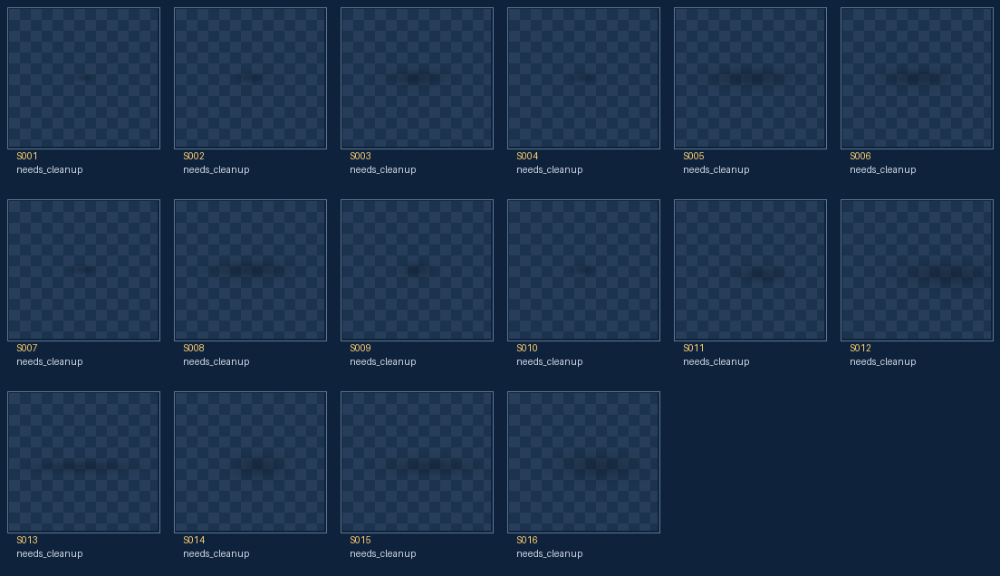

**16 PNGs** | Actual files: [map_factory/parts/shadows](../map_factory/parts/shadows)

## Stairs

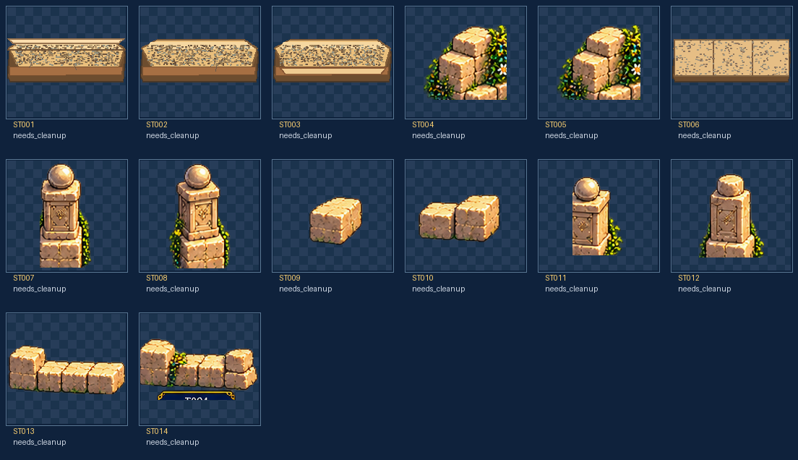

**10 PNGs** | Actual files: [map_factory/parts/stairs](../map_factory/parts/stairs)

## Ui

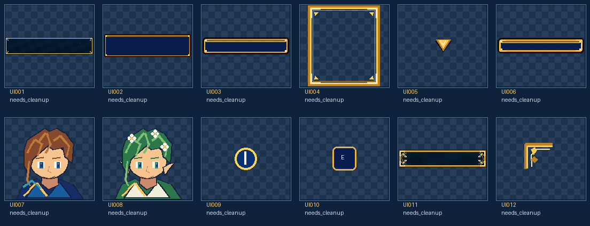

**12 PNGs** | Actual files: [map_factory/parts/ui](../map_factory/parts/ui)

## Vegetation

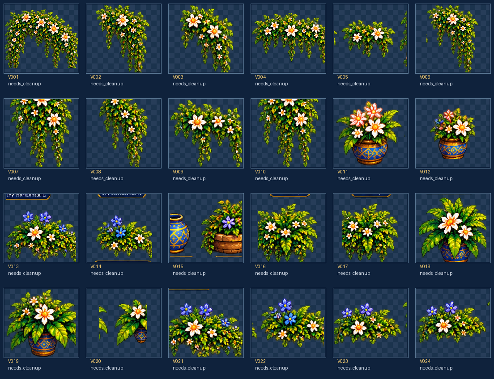

**24 PNGs** | Actual files: [map_factory/parts/vegetation](../map_factory/parts/vegetation)

## Walls

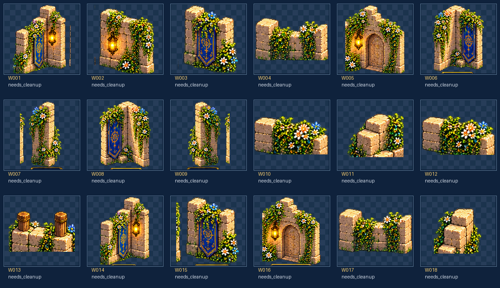

**18 PNGs** | Actual files: [map_factory/parts/walls](../map_factory/parts/walls)
