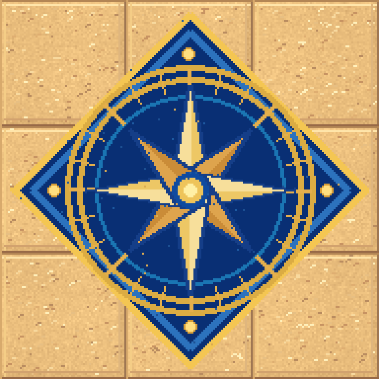
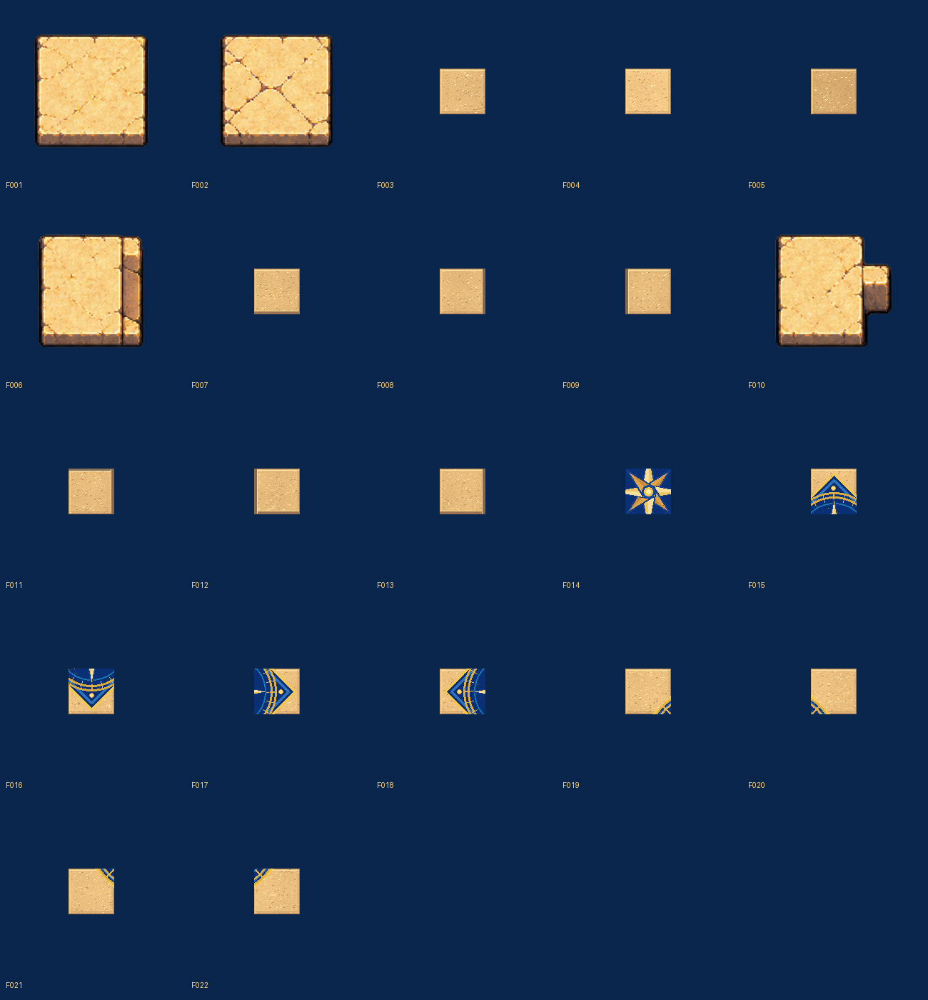

# Stone Floor 22-piece repaint

This change **replaces the 22 existing floor PNGs at stable paths**. The compass now composes into one coherent 3×3 192×192 nautical inlay; it is NOT nine copies of a single compass. Each file remains 64×64 pixel-native RGBA and therefore compatible with the room grid. Replacements are intentionally marked needs_cleanup, not approved as identical to the original reference.

The hero_room.json tile_overrides place F019 F015 F020 / F018 F014 F017 / F021 F016 F022 in a 3×3 region. Check direct Godot rendering and palette fidelity before marking ready.

## High-resolution source preservation

Visual QA showed four earlier cropped source textures contained genuinely richer stone detail than the 64px procedural replacements. **F001 F002 F006 F010 were restored byte-for-byte** from Git commit a881c847897eadcdc6c58761b968726a921918a7. Their original dimensions/source metadata were restored. The nine-part compass correction F014–F022 remains installed. Other plain/edge draft tiles remain for visual review; none are approved as a 100% visual match to the reference.
